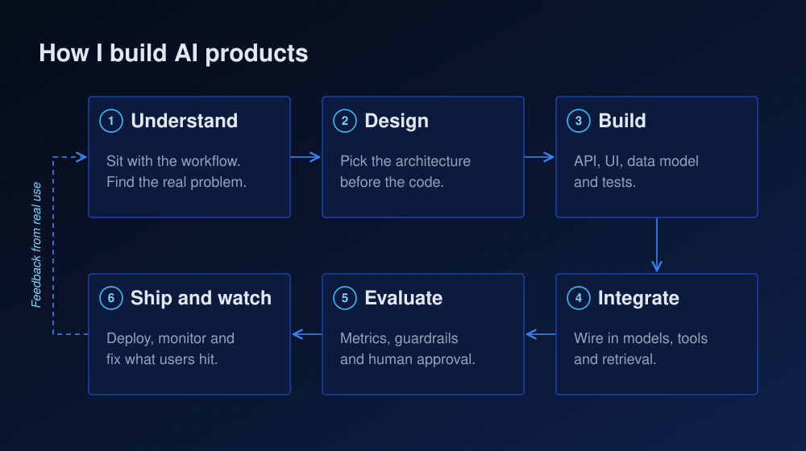

  

  
  
  

### Hi, I'm Mohit 👋

I like taking a messy, real workflow and turning it into an AI product people can actually use. Most of my work sits where language models meet real systems: agents that call tools, search that cites its sources, and the tests and guardrails that make them safe to rely on.

I finished my B.Tech in Computer Science (Data Science) in 2026. I'm looking for Applied AI, AI Engineer and Forward Deployed Engineer roles, and I'm happy to relocate.

  

### What I care about

- An agent should ask before it does anything it can't undo.
- An answer should show where it came from, or say it doesn't know.
- Quality gets checked in CI, not by feel.
- Demo data gets labelled as demo data.

### Try my work

Five of my apps are live: [Controlplane](https://controlplane-03g1.onrender.com), [AI Inference Observatory](https://ai-inference-observatory-8dp7.onrender.com), [ThreatFlow](https://threatflow-gdn3.onrender.com), [StockVision Pro](https://stockvision-pro-web.vercel.app) and [AutoMail-Agent](https://automail-agent.onrender.com). [PRIVIA](https://github.com/MohitKB22/Privia/releases/latest) installs as a desktop app on macOS, Windows and Linux. The demos run on free servers that sleep, so give one a minute to wake up.

### Tools I use most

### Certifications

<!-- Add the certificate and paper links when you have them. -->
- DataCamp: Associate AI Engineer for Developers
- Anthropic: Building with the Claude API, Introduction to Model Context Protocol, Tool Use with the Messages API, Introduction to Evals, Claude Platform 101
- Paper: *Stock Price Forecasting: A NIFTY 50 Case Study* (IJARSCT, 2026)

Want to talk? Email me at **[mohitbarse2230@gmail.com](mailto:mohitbarse2230@gmail.com)**.
